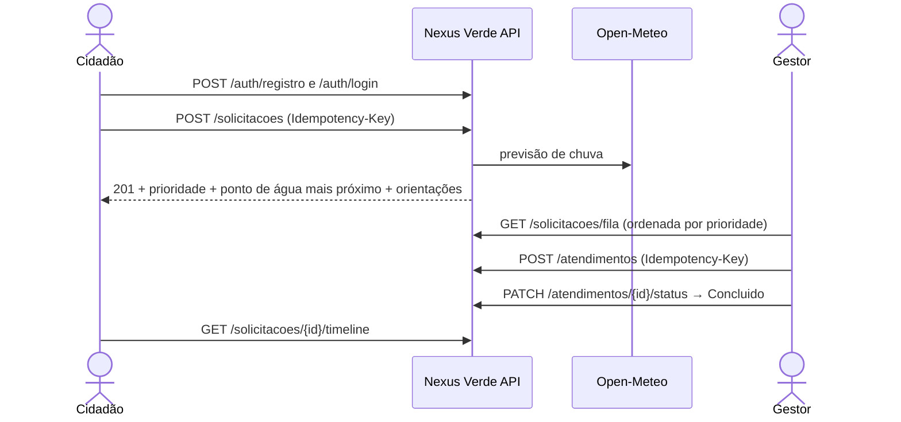
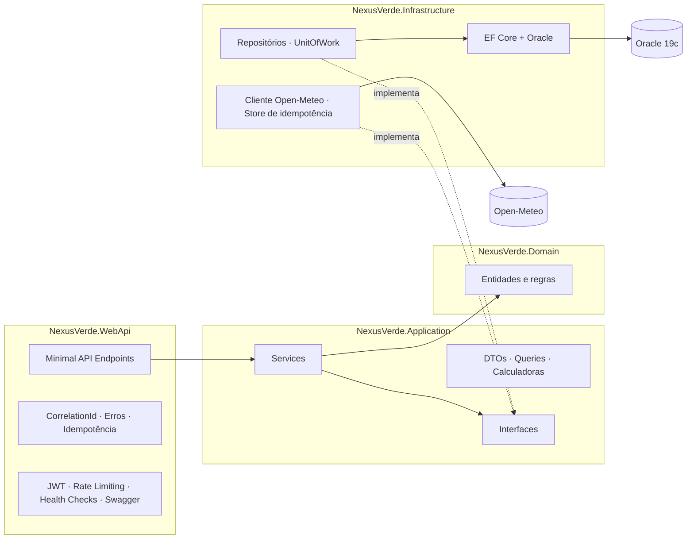

# Nexus Verde — Acesso à água potável em situações de crise

**Global Solution 2026/2 · CitizenTech · FIAP — Advanced Business Development with .NET**

> Conectando pessoas, tecnologia e água para salvar vidas.

API RESTful em **ASP.NET Core Minimal APIs (.NET 10)** com **EF Core + Oracle**. É o backend consumido pelo aplicativo mobile do Nexus Verde.

---

## Sumário
1. [O problema](#1-o-problema)
2. [A solução](#2-a-solução)
3. [Perfis de acesso](#3-perfis-de-acesso)
4. [Arquitetura](#4-arquitetura)
5. [Requisitos da disciplina](#5-requisitos-da-disciplina--onde-estão)
6. [Como executar](#6-como-executar)
7. [Autenticação JWT](#7-autenticação-jwt)
8. [Roteiro de teste](#8-roteiro-de-teste-no-swagger)
9. [Endpoints](#9-endpoints-apiv1)
10. [Idempotência, rate limiting e health checks](#10-idempotência-rate-limiting-e-health-checks)
11. [Testes automatizados](#11-testes-automatizados)
12. [Configuração](#12-configuração)
13. [Decisões técnicas](#13-decisões-técnicas)
14. [Uso de IA](#14-uso-de-ia)
15. [Integrantes](#15-integrantes)

---

## 1. O problema

O Brasil tem grandes reservas de água doce, mas milhões de pessoas têm dificuldade para acessar água potável, principalmente em regiões vulneráveis e durante desastres naturais. As enchentes no Rio Grande do Sul mostraram como uma catástrofe compromete o abastecimento, contamina fontes e deixa comunidades inteiras sem um recurso essencial.

O problema não é só a falta de água: é **saber onde ela está disponível, quem precisa de ajuda primeiro e como distribuir os recursos** com eficiência.

## 2. A solução

O Nexus Verde **não produz água: faz a água potável disponível chegar a quem precisa**. A plataforma conecta **cidadãos, órgãos públicos e equipes de resgate**.

| Capacidade | Como a API entrega |
|---|---|
| Mapear regiões afetadas | `Regiões` + `Desastres`; o risco da região é recalculado pelo desastre ativo mais grave |
| Localizar água potável | `GET /pontos-agua/proximos?lat=&lng=` (distância pela fórmula de Haversine) |
| Pedir ajuda | `POST /solicitacoes`: falta de água, água suspeita de contaminação ou acesso negado |
| Priorizar com inteligência | **Score de 0 a 100** por regras explicáveis, com chuva prevista via **Open-Meteo** |
| Orientar o cidadão | Orientações de segurança devolvidas junto com o pedido |
| Coordenar o atendimento | Fila priorizada por órgão, atendimentos e **linha do tempo** de cada solicitação |

**Roteamento automático por órgão:** `SemAgua → Prefeitura` · `AguaSuspeita → Defesa Civil` · `AcessoNegado → Polícia`.

### Score de prioridade (0–100)

| Componente | Peso máximo |
|---|---|
| Gravidade do desastre ativo na região (0 a 5) | 50 |
| Pessoas afetadas | 20 |
| Horas sem água (satura em 72h) | 20 |
| Chuva prevista nos próximos 3 dias (Open-Meteo) | 10 |
| Tipo: acesso negado +15 · água suspeita +10 | 15 |

| Score | Nível |
|---|---|
| ≥ 75 | Crítica |
| ≥ 55 | Alta |
| ≥ 30 | Média |
| < 30 | Baixa |

Se o Open-Meteo estiver fora do ar, o pedido segue normalmente, sem o componente de chuva.

**ODS da ONU:** 6 (Água potável e saneamento) · 11 (Cidades sustentáveis) · 13 (Ação contra a mudança do clima).

## 3. Perfis de acesso

| Perfil | Quem é | Pode |
|---|---|---|
| **Cidadão** | Qualquer pessoa (cadastro público) | Pedir ajuda, ver e cancelar os próprios pedidos, ver a linha do tempo deles, buscar pontos de água |
| **Gestor** | Equipe de um órgão: `DefesaCivil`, `Prefeitura`, `Bombeiros`, `Policia`, `Ong` | Ver a fila do seu órgão, atender, anotar na linha do tempo, gerir desastres e pontos de água |
| **Admin** | Administração da plataforma | Tudo, incluindo usuários, regiões e orientações |

Cada gestor vê apenas o seu órgão. **Defesa Civil e Admin coordenam e veem todos.**

### Fluxo principal



## 4. Arquitetura

Clean Architecture em 4 camadas, no padrão do projeto de referência da disciplina:



- **Domain**: entidades e invariantes (ex.: ponto de água só atende se `Ativo`; transições de status da solicitação).
- **Application**: casos de uso, DTOs, filtros e calculadoras puras (prioridade, risco, distância), testáveis sem infraestrutura.
- **Infrastructure**: EF Core + Oracle, repositórios com paginação e ordenação por whitelist, cliente HTTP do clima, store de idempotência.
- **WebApi**: Minimal APIs agrupadas por recurso (`MapGroup`), validação, segurança e pipeline.

### Modelo de dados (Oracle)

| Tabela | Conteúdo |
|---|---|
| `NV_USUARIOS` | Cidadãos, gestores e admins (senha com hash PBKDF2) |
| `NV_REGIOES` | Regiões afetadas e nível de risco |
| `NV_DESASTRES` | Desastres por região (tipo, gravidade, status) |
| `NV_PONTOS_AGUA` | Pontos de água potável |
| `NV_SOLICITACOES` | Pedidos de ajuda com score e órgão de destino |
| `NV_ATENDIMENTOS` | Atendimentos dos gestores |
| `NV_ORIENTACOES` | Orientações de segurança por tipo de pedido |
| `NV_TIMELINE` | Linha do tempo de cada solicitação (eventos e notas) |
| `NV_IDEMPOTENCIA` | Respostas guardadas das requisições idempotentes |

O DDL completo está em [`scripts/script-bd.sql`](scripts/script-bd.sql). Ele é equivalente às migrations, que a API aplica sozinha.

## 5. Requisitos da disciplina → onde estão

| # | Requisito | Implementação |
|---|---|---|
| 01 | **Minimal API RESTful** com validações e códigos HTTP | `src/NexusVerde.WebApi/Endpoints/*` · DataAnnotations via `ValidationFilter<T>` · ProblemDetails (400/401/403/404/409/422/429/503) |
| 02 | **OpenAPI / Swagger** | `/swagger` com parâmetros, contratos, respostas, botão **Authorize** e header `Idempotency-Key` documentado |
| 03 | **Idempotência** | Header `Idempotency-Key` em `POST /solicitacoes`, `POST /atendimentos` e `POST /solicitacoes/{id}/notas` (`IdempotencyMiddleware` + tabela `NV_IDEMPOTENCIA`) |
| 04 | **Rate Limiting (429)** | Política global por usuário/IP, `auth` (login/cadastro) e `criacao` · `Retry-After` |
| 05 | **JWT** | Login emite token; políticas `Cidadao`, `Gestor` e `Admin`; valida assinatura, issuer, audience e expiração |
| 06 | **Health Checks** | `/health`, `/health/live`, `/health/ready`: API, **banco Oracle** e **serviço externo Open-Meteo** |
| — | **Testes xUnit** | `tests/NexusVerde.Tests.Unit` (regras de negócio) e `tests/NexusVerde.Tests.Integration` (endpoints) |

Também tem: paginação, filtros e ordenação em todas as listagens · HATEOAS (`_links`) · Serilog com `X-Correlation-Id` · OpenTelemetry e `/metrics` · tratamento global de exceções · **nenhuma credencial no repositório**.

## 6. Como executar

**Pré-requisito:** [.NET SDK 10](https://dotnet.microsoft.com/download).

### Opção A: sem configurar nada (demonstração)

```bash
dotnet run --project src/NexusVerde.WebApi
```

Abra **http://localhost:5080/swagger**.

Em Development, sem connection string, a API sobe automaticamente com:
- **banco em memória**, já com dados de demonstração (regiões, pontos de água e orientações do RS);
- **chave JWT temporária** (ver seção 7);
- **usuários de demonstração**:

| Perfil | E-mail | Senha |
|---|---|---|
| Admin | `admin@nexusverde.demo` | `Admin#Demo2026` |
| Gestor (Defesa Civil) | `gestor@nexusverde.demo` | `Gestor#Demo2026` |
| Cidadão | `cidadao@nexusverde.demo` | `Cidadao#Demo2026` |

> Esses usuários existem **apenas no banco em memória** e nunca são criados no Oracle. Os dados somem quando a API reinicia.

### Opção B: com Oracle

Configure a conexão **fora do repositório**, com *user-secrets* (ficam só na sua máquina):

> Não faça commit desse arquivo com a senha preenchida. Sem essa linha, a API usa o banco em memória.

```powershell
dotnet user-secrets set "ConnectionStrings:Oracle" 'Data Source=oracle.fiap.com.br:1521/ORCL;User Id=SEU_RM;Password=SUA_SENHA;' --project src/NexusVerde.WebApi
dotnet user-secrets set "Seed:AdminEmail" "admin@nexusverde.com" --project src/NexusVerde.WebApi
dotnet user-secrets set "Seed:AdminPassword" 'UmaSenhaForte#2026' --project src/NexusVerde.WebApi
dotnet run --project src/NexusVerde.WebApi
```

Na subida, a API **aplica as migrations** (cria as tabelas) e **cria o admin inicial**. Não é preciso rodar o script SQL manualmente.

> No PowerShell, use **aspas simples** em valores com `$` ou `#`. Para voltar ao modo em memória: `dotnet user-secrets remove "ConnectionStrings:Oracle" --project src/NexusVerde.WebApi`.

Compatível com **Oracle 19c** (banco da FIAP).

**Alternativa sem user-secrets:** edite `src/NexusVerde.WebApi/appsettings.Development.json` e adicione a conexão com o **seu** usuário:

```json
"ConnectionStrings": {
  "Oracle": "Data Source=oracle.fiap.com.br:1521/ORCL;User Id=SEU_RM;Password=SUA_SENHA;"
}
```

## 7. Autenticação JWT

Todos os endpoints exigem token, **exceto**: login, cadastro, orientações (leitura) e health checks.

**Como obter e usar o token no Swagger:**
1. Execute `POST /api/v1/auth/login`:
   ```json
   { "email": "admin@nexusverde.demo", "senha": "Admin#Demo2026" }
   ```
2. Copie **apenas o valor** do campo `token` da resposta (sem as aspas).
3. Clique em **Authorize** (cadeado), cole o token **sem** a palavra `Bearer` e confirme.

**No Postman:** aba *Authorization* → *Bearer Token* → cole o token.

O token vale **60 minutos**. Sem token, a resposta é **401**. Com um perfil sem permissão (ex.: cidadão criando região), é **403**.

**Chave de assinatura:**
- Em Development, sem `Jwt:Key` configurada, a API gera uma **chave aleatória temporária** a cada inicialização (aviso no console). Ela fica só em memória, então tokens antigos deixam de valer quando a API reinicia.
- Para uma chave fixa (ex.: app mobile conectado): `dotnet user-secrets set "Jwt:Key" "<32+ caracteres>" --project src/NexusVerde.WebApi`, ou a variável de ambiente `Jwt__Key`.
- Em produção a chave é **obrigatória**. Nenhuma chave fica versionada.

## 8. Roteiro de teste no Swagger

| # | Usuário | Requisição | Resultado esperado |
|---|---|---|---|
| 1 | — | `GET /api/v1/regioes` sem token | **401** |
| 2 | — | `POST /api/v1/auth/login` (admin) | **200** + token → Authorize |
| 3 | Admin | `POST /api/v1/regioes` | **201** → guarde o `id` |
| 4 | Admin | `POST /api/v1/desastres` (gravidade 4 na região) | **201**; risco da região → Alto |
| 5 | Admin | `POST /api/v1/pontos-agua` | **201** |
| 6 | — | `POST /api/v1/auth/registro` + login (cidadão) | **201** / **200** → Authorize com o token do cidadão |
| 7 | Cidadão | `POST /api/v1/regioes` | **403** |
| 8 | Cidadão | `POST /api/v1/solicitacoes` com `Idempotency-Key` | **201** + prioridade + ponto mais próximo + orientações |
| 9 | Cidadão | Repetir o passo 8 com a **mesma** chave | Mesma resposta + `Idempotency-Replayed: true` (nada duplicado) |
| 10 | Cidadão | Mesma chave com corpo **diferente** | **422** |
| 11 | Admin | `GET /api/v1/solicitacoes/fila` | Fila ordenada por prioridade |
| 12 | Admin | `POST /api/v1/atendimentos` (com `solicitacaoId`) | **201** |
| 13 | Admin | `PATCH /api/v1/atendimentos/{id}/status` → `Concluido` | **200**; solicitação → Atendida |
| 14 | Cidadão | `GET /api/v1/solicitacoes/{id}/timeline` | Eventos: Criada → AtendimentoIniciado → AtendimentoConcluido |
| 15 | — | 11 logins seguidos em menos de 1 minuto | **429** + `Retry-After` |
| 16 | — | `GET /health` | Status de API, Oracle e Open-Meteo |

Exemplo de solicitação:

```http
POST /api/v1/solicitacoes
Authorization: Bearer <token do cidadão>
Idempotency-Key: 6f1d7c9e-3a52-4c1e-9f0b-1c2d3e4f5a6b
Content-Type: application/json

{
  "regiaoId": "<id da região>",
  "tipo": "AguaSuspeita",
  "descricao": "A água da torneira está turva e com cheiro forte",
  "quantidadePessoas": 12,
  "horasSemAgua": 20
}
````

> Gere a `Idempotency-Key` com `[guid]::NewGuid()` no PowerShell, ou use `{{$guid}}` no Postman.

**Collection do Postman:** [`postman/NexusVerde.postman_collection.json`](postman/NexusVerde.postman_collection.json). Importe e ajuste a variável `baseUrl` (padrão `http://localhost:5080`).

### Testando pelo Postman

Para cada requisição que envia dados (POST, PUT, PATCH), configure:

| Aba | Configuração |
|---|---|
| **Authorization** | *Type*: `Bearer Token` → cole **só** o valor do `token` do login (sem aspas e sem a palavra "Bearer") |
| **Body** | Marque **raw** e troque *Text* por **JSON** → cole o corpo da requisição |
| **Headers** | Nas criações idempotentes, adicione `Idempotency-Key` com o valor `{{$guid}}` (o Postman gera um GUID novo a cada envio) |

Erros comuns e o que significam:

| Resposta | Causa |
|---|---|
| **401** sem corpo | Token ausente, expirado ou colado com sobras (ex.: `", "expiraEm"...`). Um token válido tem dois pontos e nenhuma aspa |
| **400** "no body was provided" | A aba *Body* está em *none*: marque **raw → JSON** |
| **415** Unsupported Media Type | O *Body* está como *Text*: troque para **JSON** |
| **400** com `errors` por campo | Validação: um campo obrigatório faltou ou está fora do formato (ex.: `regiaoId` vazio) |
| **400** "Failed to read parameter... as JSON" | JSON com valor inválido (ex.: texto no lugar de um ID) |
| **404** | O ID informado não existe (ex.: o GUID de exemplo `3fa85f64-...` do Swagger) |

**Dica:** clique na collection → aba **Variables** e preencha `regiaoId`, `pontoId`, `solicitacaoId` e os tokens (`adminToken`, `cidadaoToken`) com os valores obtidos. Assim os `{{...}}` funcionam em todas as requisições. Para não colar o token em cada requisição, configure *Authorization → Bearer Token → `{{adminToken}}`* na própria collection e deixe as requisições em **Inherit auth from parent**.

**Demonstrar a idempotência no Postman:** troque `{{$guid}}` por um GUID fixo (ex.: gerado com `[guid]::NewGuid()`) e envie a mesma requisição **duas vezes**. A segunda resposta é idêntica à primeira e traz o header `Idempotency-Replayed: true`, sem criar nada novo.
```

## 9. Endpoints (`/api/v1`)

| Recurso | Rotas | Acesso |
|---|---|---|
| Auth | `POST /auth/registro` · `POST /auth/login` | Público |
| Usuários | `GET/POST /usuarios` · `GET/DELETE /usuarios/{id}` | Admin |
| Regiões | `GET /regioes` · `GET /regioes/{id}` | Autenticado |
|  | `POST /regioes` · `PUT/DELETE /regioes/{id}` | Admin |
| Desastres | `GET /desastres` · `GET /desastres/{id}` | Autenticado |
|  | `POST /desastres` · `PUT /desastres/{id}` | Gestor/Admin |
|  | `DELETE /desastres/{id}` | Admin |
| Pontos de água | `GET /pontos-agua` · `GET /pontos-agua/proximos` · `GET /pontos-agua/{id}` | Autenticado |
|  | `POST /pontos-agua` · `PUT /pontos-agua/{id}` · `PATCH /pontos-agua/{id}/status` | Gestor/Admin |
|  | `DELETE /pontos-agua/{id}` | Admin |
| Solicitações | `POST /solicitacoes` · `GET /solicitacoes/minhas` · `PATCH /solicitacoes/{id}/cancelar` | Cidadão |
|  | `GET /solicitacoes/fila` · `POST /solicitacoes/{id}/notas` | Gestor/Admin |
|  | `GET /solicitacoes/{id}` · `GET /solicitacoes/{id}/timeline` | Autor, gestor do órgão ou Admin |
| Atendimentos | `POST /atendimentos` · `GET /atendimentos` · `GET /atendimentos/{id}` · `PATCH /atendimentos/{id}/status` | Gestor/Admin |
| Orientações | `GET /orientacoes` · `GET /orientacoes/{id}` | **Público** |
|  | `POST /orientacoes` · `PUT/DELETE /orientacoes/{id}` | Admin |
| Operação | `GET /health` · `/health/live` · `/health/ready` · `/metrics` | Público |

**Paginação, filtros e ordenação** em todas as listagens, todos **opcionais**: `?page=1&pageSize=10&sortBy=<campo>&desc=true`, mais os filtros de cada recurso (ex.: `/regioes?estado=RS&nivelRisco=Alto&busca=porto`). Sem parâmetros: página 1 com 10 itens. `pageSize` máximo: 50. As respostas trazem `_links` (HATEOAS) de navegação e das ações permitidas ao perfil.


## 10. Idempotência, rate limiting e health checks

### Idempotência
1. O cliente envia `Idempotency-Key: <uuid>`. É obrigatório nas operações de criação; sem ele, a resposta é **400**.
2. A primeira requisição é executada e a resposta (status + corpo) é gravada, isolada por **usuário + chave + rota**.
3. **Mesma chave e mesmo corpo**: devolve a resposta original (`Idempotency-Replayed: true`) **sem criar outro registro**. Cobre o app mobile reenviando após queda de rede, inclusive com requisições simultâneas.
4. **Mesma chave com corpo diferente**: **422**.
5. A rota é normalizada (`/solicitacoes` e `/solicitacoes/` contam como a mesma) e a chave vale por **24h** (`Idempotency:RetentionHours`). Só respostas 2xx são memorizadas.

### Rate limiting

| Política | Aplicada em | Padrão |
|---|---|---|
| Global | Todas as rotas (por usuário; por IP se anônimo) | 120 / min |
| `auth` | `POST /auth/login`, `/auth/registro` (por IP) | 10 / min |
| `criacao` | `POST /solicitacoes`, `/atendimentos`, `/solicitacoes/{id}/notas` (por usuário) | 20 / min |

Ao exceder, a resposta é **429 Too Many Requests** com `Retry-After` e ProblemDetails. Os limites são ajustáveis em `RateLimiting:*`.

### Health checks

| Rota | Verifica |
|---|---|
| `/health` | Tudo: API, banco e Open-Meteo |
| `/health/live` | Se a API está no ar |
| `/health/ready` | Dependências: **banco Oracle** e **Open-Meteo** |

Open-Meteo fora do ar deixa o status em **Degraded** (HTTP 200): a API continua atendendo, só sem o dado de chuva. Banco fora do ar deixa o status em **Unhealthy** (HTTP 503).

## 11. Testes automatizados

```bash
dotnet test
```

São **292 testes** (xUnit), que rodam sem Oracle e sem internet (EF InMemory e clima simulado).

- **Unitários** (`tests/NexusVerde.Tests.Unit`): regras de domínio, calculadoras de prioridade, risco e distância, services com Moq, HATEOAS e paginação.
- **Integração** (`tests/NexusVerde.Tests.Integration`), com a API real via `WebApplicationFactory`:
  - fluxos completos de cidadão, gestor e admin;
  - JWT: sem token, token inválido, expirado, assinatura errada, issuer e audience errados, 403 por perfil;
  - idempotência: replay, corpo diferente (422), barra final, 5 requisições simultâneas e chave expirada;
  - rate limiting: 429 no login e na criação, limite por usuário;
  - health checks, incluindo Degraded com o serviço externo fora do ar;
  - Swagger, paginação opcional, linha do tempo, correlation id e métricas;
  - inicialização sem nenhuma configuração.

## 12. Configuração

Nenhuma credencial fica no repositório. Use *user-secrets* (desenvolvimento) ou variáveis de ambiente (produção). Veja [`.env.example`](.env.example).

| Chave (user-secrets) / variável de ambiente | Para quê |
|---|---|
| `ConnectionStrings:Oracle` / `ConnectionStrings__Oracle` | Conexão Oracle (sem ela, em Development, usa o banco em memória) |
| `Jwt:Key` / `Jwt__Key` | Chave do JWT, 32+ caracteres (obrigatória fora de Development) |
| `Seed:AdminEmail` · `Seed:AdminPassword` | Admin inicial, criado se ainda não existir |
| `Database:UseInMemory` | `true` força memória, `false` força Oracle; sem valor, automático |
| `Database:RunSeedOnStartup` | Carrega dados de demonstração (padrão em Development) |
| `Database:ApplyMigrationsOnStartup` | Aplica migrations ao subir (padrão `true`) |
| `Idempotency:RetentionHours` | Validade da Idempotency-Key (padrão 24) |
| `RateLimiting:*` · `Cors:AllowedOrigins:N` | Limites de requisição e origens web permitidas |

**Migrations (EF Core):**
```bash
dotnet ef database update -p src/NexusVerde.Infrastructure -s src/NexusVerde.WebApi
dotnet ef migrations script -p src/NexusVerde.Infrastructure -s src/NexusVerde.WebApi -o scripts/script-bd.sql
```

## 13. Decisões técnicas

- **Minimal APIs** (requisito 01), com a estrutura em camadas do projeto de referência.
- **Execução sem configuração em Development**: o avaliador roda `dotnet run` e testa na hora. Produção nunca cai em memória por engano.
- **Priorização por regras** explicáveis e testáveis: o gestor entende por que um pedido está no topo.
- **Open-Meteo** (API pública, sem chave) como serviço externo. Uma falha nunca derruba a API.
- **Linha do tempo no próprio Oracle** (`NV_TIMELINE`): uma única base, consistente e simples de operar.
- **Guid** como identificador e **enums como texto**, no banco e no JSON (legíveis para o mobile).
- **Erros padronizados** em ProblemDetails (RFC 7807) com `correlationId` para rastrear nos logs.

## 14. Uso de IA

Ferramentas de IA generativa foram usadas como **apoio** à implementação, à geração de testes e à revisão de texto. O grupo definiu o problema, o domínio, as regras de negócio e as decisões de arquitetura, e revisou, executou e validou o código entregue.


## 15. Integrantes

| Nome | RM |
|---|---|
| Mathaus Victor Souza Marcelino | RM564146 |
| Luan Peixoto Marins Rocha | RM562258 |
| Vinicius Luis | RM563340 |
| Eduardo Novaes Mollo | RM561515 |
| Carlos Alberto Guedes Neto | RM566022 |

Identificação completa no arquivo `identificacao.txt`.